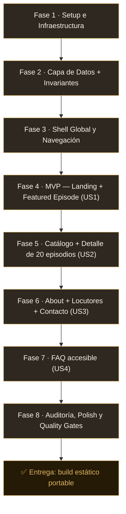

# 🎙️ Slow Signals — Podcast Web Application

<div align="center">


<p align="center">
  <strong>Una aplicación web estática, minimalista y de alto rendimiento para podcasting digital.</strong>
  <br />
  <em>Desarrollada bajo estándares estrictos de Clean Code, diseño atómico y tipado estricto.</em>
</p>

[✨ Ver Demo Local](#-guía-de-instalación-y-clonado) •
[🗺️ Rutas](#-visión-general) •
[📐 Arquitectura](#-arquitectura-y-estructura-del-proyecto) •
[🧪 Quality Gates](#-pruebas-y-quality-gates) •
[🚀 Despliegue](#-despliegue-estático)

---

</div>

## 📖 Índice

- [🌟 Visión General](#-visión-general)
- [🗺️ Mapa de Rutas](#-mapa-de-rutas)
- [🎯 Progreso del Ejercicio Guiado](#-progreso-del-ejercicio-guiado)
- [📐 Arquitectura y Estructura del Proyecto](#-arquitectura-y-estructura-del-proyecto)
- [💎 Principios de Clean Code Aplicados](#-principios-de-clean-code-aplicados)
- [🎨 Sistema de Diseño y Accesibilidad](#-sistema-de-diseño-y-accesibilidad)
- [🧪 Pruebas y Quality Gates](#-pruebas-y-quality-gates)
- [📥 Guía de Instalación y Clonado](#-guía-de-instalación-y-clonado)
- [🚀 Despliegue Estático](#-despliegue-estático)

---

## 🌟 Visión General

**Slow Signals** es una aplicación web de podcast construida con **Next.js 15 (App Router)** en modo **Static Export** (`output: 'export'`): el servidor compila todas las rutas a HTML puro en la carpeta `out/`, sin backend, sin base de datos y sin llamadas a feeds externos.

### ✨ Características Principales

- ⚡ **Zero Server Overhead:** exportación puramente estática (27 páginas pre-renderizadas), primer cargado de **103–109 kB** y páginas de **8–206 kB** transferidos — muy por debajo del presupuesto de 500 kB.
- 🗂️ **Fuente Única de Verdad (SSOT):** los 20 episodios, el show, los locutores y el FAQ viven únicamente en `src/data/`; la landing, el catálogo y el detalle se renderizan desde los mismos objetos tipados.
- 🛡️ **Invariantes en Compilación:** el build falla si no hay exactamente 20 episodios, si se repiten slugs/números, si no hay exactamente 1 destacado o si las fechas no siguen la cadencia semanal.
- 🎨 **Estética Editorial Premium:** paleta cálida (*warm ink, ivory, muted gold*), tipografía *Playfair Display* + *Inter* (self-hosted, sin CDN externo) y micro-interacciones suaves con CSS Modules.
- ♿ **Accesibilidad WCAG 2.1 AA:** enlace *Skip-to-content*, landmarks semánticos, `:focus-visible`, menú operable por teclado, `<details>` nativo en el FAQ y **Lighthouse a11y = 100** en todas las rutas.
- 🧭 **Cero enlaces rotos:** las 4 páginas + 20 fichas de episodio + 404 amigable resuelven correctamente en cualquier servidor estático.

---

## 🗺️ Mapa de Rutas

| Ruta | Página | Contenido |
| :--- | :--- | :--- |
| `/` | Landing | Identidad del show + **exactamente 1** episodio destacado (nº, título, descripción, fecha, duración) |
| `/episodes/` | Catálogo | Los **20 episodios**, de más reciente a más antiguo, con los 5 campos obligatorios |
| `/episodes/[slug]/` | Detalle | Descripción completa + navegación a episodio anterior/siguiente (20 rutas pre-renderizadas) |
| `/about/` | About | Premisa del show, ficha de cada locutor (nombre, rol, bio) y enlaces de contacto |
| `/faq/` | FAQ | 8 preguntas en 3 categorías, con respuestas desplegables accesibles |
| cualquier otra | 404 | Vista amigable con navegación funcional de vuelta a todas las páginas |

---

## 🎯 Progreso del Ejercicio Guiado

El proyecto sigue la metodología **spec-driven** (`specs/001-podcast-website/`): especificación → plan → investigación → contratos → tareas → implementación → verificación.



### ✅ Hitos completados

- [x] **Fase 1 — Setup:** Next.js 15 + TypeScript estricto + ESLint + tokens de diseño.
- [x] **Fase 2 — Datos e invariantes:** 20 episodios tipados con validación en build (`src/data/invariants.ts`).
- [x] **Fase 3 — Shell accesible:** `layout.tsx` con skip-link, `header/nav/main/footer`, `aria-current` en la ruta activa.
- [x] **Fase 4 — MVP (US1):** landing con identidad + episodio destacado; verificada en navegador.
- [x] **Fase 5 — Catálogo (US2):** `/episodes/` con 20 tarjetas y `/episodes/[slug]/` con `generateStaticParams()` (20 rutas SSG).
- [x] **Fase 6 — About (US3):** premisa, locutores (`HostCard`), 3 enlaces de contacto y arte del show con texto alternativo descriptivo.
- [x] **Fase 7 — FAQ (US4):** 8 preguntas agrupadas en 3 categorías con `<details>` nativo (sin JavaScript).
- [x] **Fase 8 — Auditoría y polish:**
  - [x] Eliminación de artefactos temporales (`tsconfig.tsbuildinfo`) y verificación de ausencia de duplicados/anidamientos redundantes.
  - [x] Refactor DRY: fechas/duraciones centralizadas en `src/lib/format.ts`; estilos `inline` eliminados en favor de CSS Modules.
  - [x] Corrección de portabilidad: `trailingSlash: true` evita la colisión `out/episodes.html` vs `out/episodes/` en servidores estáticos.
  - [x] Per-route `metadata` + Open Graph en las 4 páginas y en el detalle.
  - [x] Quickstart V1–V6 ejecutado sobre el build de producción.

---

## 📐 Arquitectura y Estructura del Proyecto

Separación estricta de responsabilidades: **rutas** (`app/`) orquestan, **componentes** (`components/`) presentan con estilos encapsulados, **datos** (`data/`) son inmutables y **utilidades** (`lib/`) son funciones puras sin estado.

```text
mi-podcast/
├── 📁 public/                          # Recursos estáticos (SVG: comprimidos por diseño)
│   ├── favicon.svg                     # Icono del sitio
│   └── show-art.svg                    # Arte del show (usado en About, con alt descriptivo)
│
├── 📁 src/
│   ├── 📁 app/                         # App Router — una carpeta = una ruta
│   │   ├── layout.tsx                  # Shell raíz: skip-link, header, nav, main, footer, fuentes
│   │   ├── layout.module.css           # Estilos del header/wordmark (sin estilos inline)
│   │   ├── page.tsx                    # Ruta `/` — Landing (Hero + FeaturedEpisode)
│   │   ├── page.module.css             # Estilos de la CTA de la landing
│   │   ├── not-found.tsx               # 404 amigable con navegación (FR-012)
│   │   ├── not-found.module.css        # Estilos del 404
│   │   ├── episodes/
│   │   │   ├── page.tsx                # Ruta `/episodes/` — catálogo completo (FR-003)
│   │   │   ├── [slug]/page.tsx         # Ruta `/episodes/[slug]/` — detalle SSG (FR-004)
│   │   │   └── [slug]/page.module.css  # Estilos del artículo de detalle
│   │   ├── about/
│   │   │   ├── page.tsx                # Ruta `/about/` — premisa, locutores, contacto (FR-005)
│   │   │   └── page.module.css         # Rejilla de About + tarjetas de locutores
│   │   └── faq/
│   │       ├── page.tsx                # Ruta `/faq/` — 8 preguntas en 3 categorías (FR-006)
│   │       └── page.module.css         # Estilos de categorías y lista
│   │
│   ├── 📁 components/                  # UI desacoplada: 1 componente = 1 responsabilidad
│   │   ├── Navigation.tsx · .module.css        # Nav principal con detección de ruta activa
│   │   ├── Footer.tsx · .module.css            # Pie con créditos dinámicos
│   │   ├── Hero.tsx · .module.css              # Encabezado de la landing (h1 + tagline + CTAs)
│   │   ├── FeaturedEpisode.tsx · .module.css   # Tarjeta del episodio destacado
│   │   ├── EpisodeCard.tsx · .module.css       # Entrada del catálogo
│   │   ├── EpisodeList.tsx · .module.css       # Lista ordenada (dueña de la semántica de lista)
│   │   ├── HostCard.tsx · .module.css          # Ficha de locutor (nombre, rol, bio)
│   │   ├── FaqItem.tsx · .module.css           # Pregunta desplegable (<details> nativo)
│   │   └── PageHeader.tsx · .module.css        # Cabecera de página compartida (garantiza 1 h1)
│   │
│   ├── 📁 data/                        # Única fuente de verdad — datos inmutables
│   │   ├── types.ts                    # Entidades del dominio: Episode, Show, Host, FAQItem
│   │   ├── episodes.ts                 # Los 20 episodios + selectores tipados
│   │   ├── show.ts                     # Nombre, tagline, descripción y enlaces de contacto
│   │   ├── hosts.ts                    # Locutores
│   │   ├── faq.ts                      # Preguntas/respuestas categorizadas
│   │   └── invariants.ts               # Aserciones de build (fail-fast) + getFeaturedEpisode()
│   │
│   ├── 📁 lib/                         # Utilidades puras (DRY)
│   │   └── format.ts                   # formatPublishDate · formatDuration · formatEpisodeNumber
│   │
│   └── 📁 styles/                      # Sistema de diseño global
│       ├── tokens.css                  # Variables CSS: paleta, escala tipográfica, espaciado
│       └── globals.css                 # Reset, base semántica, .skip-link, :focus-visible, utilidades
│
├── 📁 specs/001-podcast-website/       # Documentación spec-driven: spec, plan, research,
│                                       # data-model, contracts/, quickstart y tasks
├── ⚙️ next.config.ts                   # output: 'export' + trailingSlash: true
├── ⚙️ tsconfig.json                    # strict: true, noEmit, alias @/*
├── ⚙️ .eslintrc.json                   # next/core-web-vitals
└── 📦 package.json                     # Scripts de automatización (dev/build/lint/typecheck/test)
```

---

## 💎 Principios de Clean Code Aplicados

| Principio | Aplicación en el proyecto |
| :--- | :--- |
| **SRP** | Cada componente renderiza una cosa; los datos nunca se formaten ni se copian en las vistas. |
| **DRY** | `src/lib/format.ts` centraliza fechas/duraciones/números; `PageHeader` evita repetir cabeceras; los tokens CSS evitan repetir valores mágicos. |
| **Tipado estricto** | 100% TypeScript, **cero `any`**, cero `@ts-ignore`, `strict: true`. |
| **SSOT** | Un solo módulo define los episodios: landing, catálogo y detalle renderizan exactamente los mismos objetos (FR-011). |
| **Fail-Fast** | `assertEpisodeInvariants()` se ejecuta al cargar el módulo: el build se detiene ante cualquier inconsistencia del dataset. |
| **Sin estilos inline** | Todo el CSS vive en `*.module.css` (scoping por componente) o en tokens globales. |
| **Sin código muerto** | Sin artefactos temporales, sin carpetas anidadas redundantes, sin archivos duplicados. |

---

## 🎨 Sistema de Diseño y Accesibilidad

| Elemento | Implementación |
| :--- | :--- |
| **Paleta** | Fondo carbón cálido (`#0c0a09`), superficie elevada (`#16130f`), acento dorado (`#e0b464`) y texto marfil (`#f5f1ea`). |
| **Tipografía** | Editorial self-hosted: *Playfair Display* (títulos) e *Inter* (cuerpo) vía `next/font`. |
| **Contraste** | Pares de color ≥ 4.5:1 (WCAG 2.1 AA) definidos en `tokens.css`. |
| **Accesibilidad** | Skip-to-content, landmarks, un `h1` por página, `:focus-visible`, `aria-current`, `aria-labelledby` y `<details>` nativo en el FAQ. |
| **Adaptativo** | Mobile-first verificado a **360 px sin scroll horizontal** en todas las rutas. |

---

## 🧪 Pruebas y Quality Gates

```bash
# 1. Análisis estático (ESLint)
npm run lint

# 2. Comprobación estricta de tipos sin emisión
npm run typecheck

# 3. Compilación estática de producción + invariantes del dataset
npm run build

# 4. Suite completa de gates en secuencia (lint → typecheck → build)
npm test
```

### Estado de los gates (última ejecución)

| Gate | Comando | Estado |
| :--- | :--- | :--- |
| Lint | `npm run lint` | ✅ 0 errores, 0 warnings |
| Tipos | `npm run typecheck` | ✅ 0 errores |
| Build + invariantes | `npm run build` | ✅ 27 páginas estáticas |
| **Suite completa** | `npm test` | ✅ **PASS** |

### Verificación en navegador (sobre el build de producción)

- ✅ V1–V5: los escenarios de cada user story pasan en `/`, `/episodes/`, `/episodes/[slug]/`, `/about/` y `/faq/`.
- ✅ Slug inexistente (`/episodes/nope/`) → 404 amigable con navegación funcional.
- ✅ **0** mensajes de consola (errores/avisos) en todas las rutas.
- ✅ **Lighthouse** (desktop): Accesibilidad, Buenas Prácticas y SEO = **100** en las 5 rutas principales.
- ✅ Peso transferido por página: 8–206 kB (presupuesto: 500 kB).

---

## 📥 Guía de Instalación y Clonado

### 1. Clonar el repositorio

```bash
git clone https://github.com/TU-USUARIO/mi-podcast.git
cd mi-podcast
```

### 2. Instalar dependencias

```bash
npm install
```

### 3. Ejecución en desarrollo

```bash
npm run dev
```

Abre en tu navegador: **[http://localhost:3000](http://localhost:3000)**

### 4. Verificar antes de entregar

```bash
npm test           # todos los quality gates en secuencia
npm run build      # genera out/
npm run preview    # sirve out/ en local para la revisión final
```

> Requisito: **Node.js 20+**. No hay claves de API, bases de datos ni variables de entorno: el contenido es fictional y está embebido en el repositorio.

---

## 🚀 Despliegue Estático

```bash
npm run build
```

Next.js genera la carpeta **`out/`** — HTML, CSS y JS estáticos listos para cualquier CDN o hosting sin servidor:

```text
out/
├── index.html                        # Landing
├── 404.html                          # 404 raíz (requisito de GitHub Pages)
├── episodes/index.html               # Catálogo
├── episodes/episode-01/ … episode-20/index.html   # 20 fichas pre-renderizadas
├── about/index.html · faq/index.html
└── _next/static/…                    # JS/CSS con hash de contenido
```

La configuración `trailingSlash: true` garantiza que **cada ruta sea un directorio con su `index.html`**, evitando la colisión entre `episodes.html` y el directorio `episodes/` que rompe las URLs sin extensión en servidores estáticos (GitHub Pages, `serve`, CDNs genéricos).

Funciona sin cambios en **GitHub Pages, Netlify, Vercel, Cloudflare Pages** o cualquier servidor de archivos. Para previsualizar en local:

```bash
npm run preview   # sirve out/ y respeta la misma estructura que un CDN
```

---

<div align="center">
  <sub>Diseñado y estructurado con ❤️ para demostración académica y buenas prácticas de ingeniería de software.</sub>
</div>
